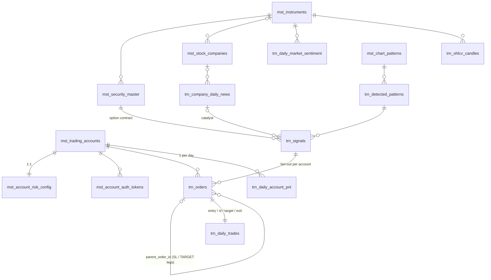

# Phase 1 — PostgreSQL Schema (`mst` / `trn`) via EF Core

**Stack:** .NET 10 · EF Core 10.0.14 · Npgsql 10.0.3 · EFCore.NamingConventions (snake_case) · PostgreSQL 16

| Artifact | Path |
|---|---|
| Entities + enums | `backend/src/TradeBot.Domain` |
| `TradeBotDbContext`, Fluent configs, conventions, AES-GCM | `backend/src/TradeBot.Infrastructure` |
| EF migration | `backend/src/TradeBot.Infrastructure/Persistence/Migrations` |
| Idempotent SQL (for review / ops) | `db/migrations/0001_initial_mst_trn_schema.sql` |
| Integration tests (real PostgreSQL) | `backend/tests/TradeBot.Infrastructure.Tests` |

Totals: **22 tables** (12 `mst` incl. EF history, 10 `trn`), **104 CHECK constraints**, **31 foreign keys**, **77 indexes**.

## Relationships



## Tables

### `mst` — master / configuration
| Table | Purpose / notable columns |
|---|---|
| `trading_accounts` | `trade_mode` PAPER/REAL, `is_data_provider` (unique: one active), AES-GCM `api_key`, `api_secret`, `totp_secret`, `login_password`, `login_pin`; `real_mode_enabled_at/by` |
| `account_auth_tokens` | Encrypted `x_jwt_token`, `public_access_token`, `read_access_token`, `token_expiry`, `login_status`, `login_method` (HEADLESS/MANUAL), `attempt_count` |
| `account_risk_config` | 1:1 with account. Capital, margins, risk %, premium band, `default_sl_pct`, `default_target_pct`, `min_risk_reward_ratio`, `max_sl_pct`, breakeven/trailing %, daily loss/profit, sizing, slippage, simulated costs |
| `instruments` | Underlyings (NIFTY, BANKNIFTY, F&O stocks): lot/tick size, `strike_step`, `has_weekly_expiry`, `is_tradable` |
| `stock_companies` | NSE symbol, sector, F&O flag, NIFTY50 / BANKNIFTY / FINNIFTY weight % |
| `security_master` | Daily Paytm Money scrip sync; `security_id` is the broker id (not generated); option rows must have strike + CE/PE + expiry |
| `chart_patterns` | Pattern catalog: code, category, direction, min candles, weight, `pattern_parameters` JSONB |
| `charge_rates` | STT, exchange txn, SEBI, stamp duty, GST, brokerage — effective-dated per security type |
| `gemini_news_config` | Encrypted API key, model, grounding, schedule, weights (CHECK sum = 100), `veto_min_impact_level` |
| `strategy_config` | Strike selection, expiry policy, product, 15m/5m timeframes, entry window, square-off, auth time/retries |
| `alert_channels` | Telegram bot token (encrypted) + chat id, notify flags |

### `trn` — transactions / runtime
| Table | Purpose / notable columns |
|---|---|
| `company_daily_news` | Gemini output per headline; `sentiment_score` −100..100, `impact_level`, weighted NIFTY/BANKNIFTY impact; dedupe on `(trading_date, content_hash)` |
| `daily_market_sentiment` | One row per instrument per day; `trading_halt_active` |
| `ohlcv_candles` | Multi-timeframe candles; unique `(instrument, security, timeframe, candle_time)` with `NULLS NOT DISTINCT` |
| `detected_patterns` | Structural SL / target / breakout must be ordered for direction |
| `signals` | **`mandatory_sl_price`, `mandatory_target_price` NOT NULL**; `risk_reward_ratio` is a DB-generated column |
| `orders` | **`stop_loss_price`, `target_sell_price` NOT NULL on every leg**; `parent_order_id` links SL/TARGET legs to the entry; `idempotency_key` unique |
| `daily_trades` | Trade book: entry / SL / trailing SL / target / exit, `net_pnl` generated |
| `daily_account_pnl` | Daily ledger per account; `net_pnl` generated; kill-switch and profit-lock flags |
| `daily_bot_state` | Global kill switch per trading date |
| `system_events` | Audit trail (mode toggles, kill switch, auth failures) |

## Mandatory SL / Target enforcement in the database

| Constraint | Rule |
|---|---|
| `ck_signals_mandatory_sl_target` | All > 0; BUY: `sl < entry < target`; SELL: mirrored |
| `ck_signals_risk_reward_positive` | Generated `risk_reward_ratio > 0` |
| `ck_orders_mandatory_sl_target` | Every leg: `stop_loss_price > 0 AND target_sell_price > stop_loss_price` |
| `ck_orders_entry_bracket` | ENTRY: `sl < order_ltp < target` and `sl < price < target` (price includes the slippage buffer) |
| `ck_orders_parent_link` | ENTRY has no parent; every SL/TARGET/EMERGENCY leg must have one |
| `ck_orders_long_only` | ENTRY = Buy, exit legs = Sell (option buying only) |
| `ck_orders_leg_order_type` | STOP_LOSS leg is `SL`, TARGET_SELL leg is `LMT` |
| `ck_orders_sl_trigger` | `SL` orders need `trigger_price > 0`; sell SL-L `price <= trigger_price` |
| `ck_daily_trades_mandatory_sl_target` | `0 < sl < entry < target` |
| `ck_daily_trades_trailing_sl` | `sl <= trailing_sl < target` (trailing never loosens) |
| `ck_daily_trades_exit_state` | OPEN ⇔ no exit price/time |
| `ck_detected_patterns_structural_levels` | Bullish: `sl < breakout < target`; bearish mirrored |
| `ck_account_risk_config_fallback_rr` | `default_target_pct >= default_sl_pct × min_risk_reward_ratio` (the fixed fallback can never break min RR) |

Other safety-related constraints: `ck_trading_accounts_real_mode_confirmed` (REAL needs `real_mode_enabled_at`), a unique index allowing a single active data provider, single active `gemini_news_config` / `strategy_config`, strategy session window inside 09:15–15:29, and every enum column has an `IN (...)` CHECK.

## Conventions
- **Keys:** `bigint GENERATED BY DEFAULT AS IDENTITY` (modern BIGSERIAL). `security_master.security_id` = broker id; `daily_bot_state` keyed by `trading_date`.
- **Types:** prices/PnL `numeric(18,2)`, percentages `numeric(7,4)`, scores `numeric(5,2)`, timestamps `timestamptz` (UTC), `trading_date` defaults to the IST calendar date.
- **Enums:** stored as text (`'PAPER'`, `'SL_HIT'`, `'1m'`, `'B'`, …) with auto-generated CHECKs; no PostgreSQL enum types, so adding a value is a one-line migration.
- **Encryption:** properties marked `[Encrypted]` go through an EF Core value converter (AES-256-GCM, `v1:` prefix). The key never reaches the DB.
- **Concurrency:** `trading_accounts`, `account_risk_config`, `orders`, `daily_trades`, `daily_account_pnl`, `daily_bot_state` use PostgreSQL `xmin` as the row version, so the OCO engine can't double-exit a trade.
- **Deletes:** every FK is `ON DELETE RESTRICT`; accounts and patterns are deactivated, never deleted.
- **Migrations history:** `mst.__ef_migrations_history`.

## Additions beyond the original spec
| Addition | Why |
|---|---|
| `mst.strategy_config`, `mst.charge_rates`, `mst.alert_channels` | Holds the Phase 0 decisions (ATM, expiry policy, 15m/5m, 14:45/15:15, Telegram) and the statutory charge rates for Paper Net PnL |
| `trn.daily_bot_state`, `trn.system_events` | Global kill switch and audit trail |
| `MANUAL_EXIT` trade status, `exit_order_id` | Needed by the dashboard Manual Exit button |
| `orders.idempotency_key`, `filled_quantity`, `avg_fill_price`, `rejection_reason` | Safe retries and partial-fill handling |
| `trading_accounts.login_id/login_password/login_pin` | Headless Playwright login |
| `account_risk_config.max_sl_pct`, `breakeven_trigger_pct`, `simulated_slippage_pct` | Hybrid SL cap, breakeven-then-trail rule, Paper slippage |
| `signals.sl_method`, `pattern/news/oi_greeks_score`, `status` | Explains every signal on the dashboard |

## Assumed defaults (editable rows, please confirm)
| Setting | Default |
|---|---|
| `max_sl_pct` (cap for structural SL) | 25% |
| `max_lots_per_trade` | 10 |
| `simulated_slippage_pct` (Paper) | 0.25% |
| `volume_spike_trigger_multiplier` | 2.5× 20-bar average |
| `intraday_poll_seconds` | 60 |
| `max_calls_per_minute` (Gemini) | 30 |

## Running it
```bash
export TRADEBOT_DB="Host=localhost;Database=tradebot;Username=tradebot;Password=***"
dotnet ef database update -p backend/src/TradeBot.Infrastructure -s backend/src/TradeBot.Infrastructure
# or: psql -f db/migrations/0001_initial_mst_trn_schema.sql   (idempotent)

export TRADEBOT_TEST_DB="Host=localhost;Database=tradebot_test;Username=tradebot;Password=***"   # role needs CREATEDB
dotnet test backend/TradeBot.slnx
```

Seed data (80+ chart patterns, F&O stocks with index weights, accounts, charge rates) is scheduled for Phase 5.
