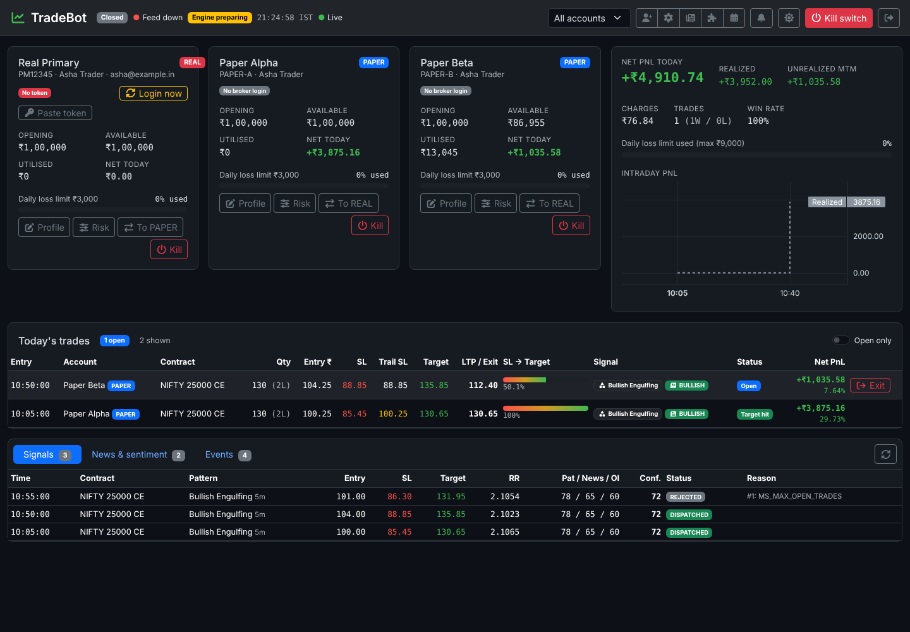
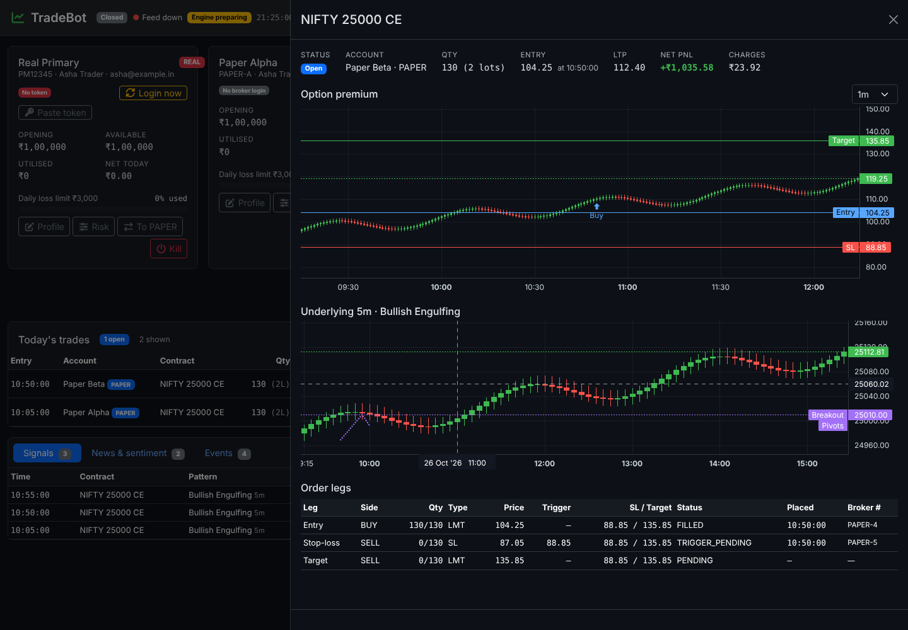
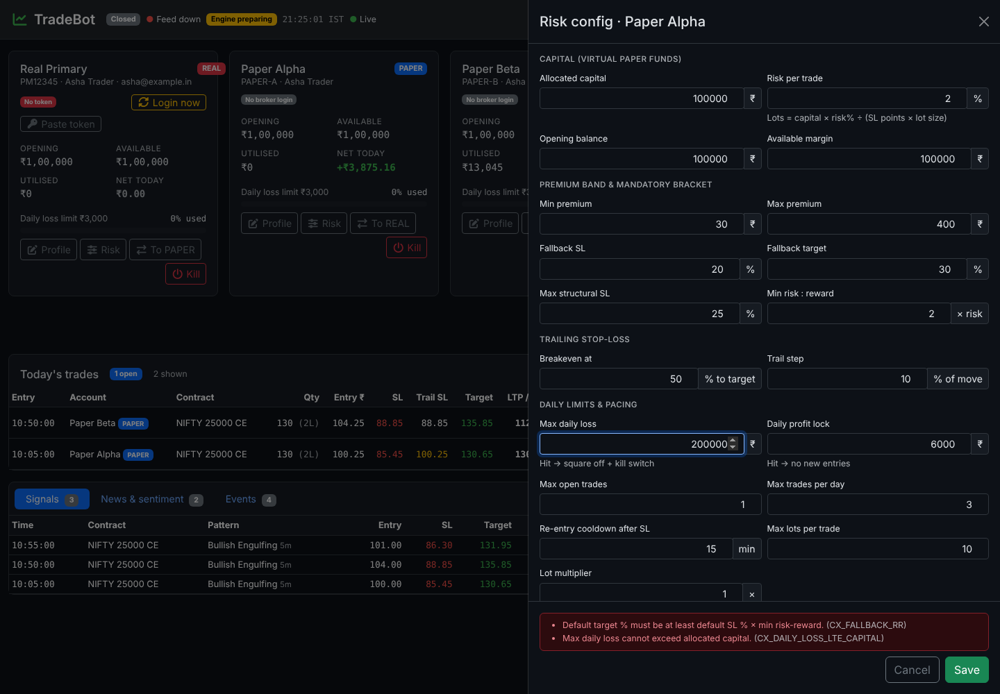
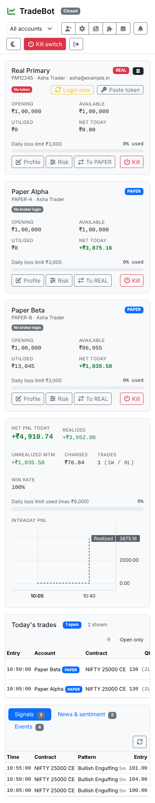

# Phase 4: Unified Angular Dashboard

Angular 22 (standalone, zoneless, OnPush by default), RxJS, Bootstrap 5.3, FontAwesome, TradingView lightweight-charts. The source is in `frontend/`.



## 1. Screen
One page; every editor opens as an offcanvas drawer over it, so the trade book stays visible.

| Area | Content | Source |
|---|---|---|
| Header | Market session, feed state, engine readiness, IST clock, socket link state, scope (All / REAL / PAPER / one account), config buttons, mute, theme, global kill switch, sign-out | `/ws/dashboard` overview |
| Account cards | Profile (client ID, holder, email), mode and data-provider badges, broker-token status with live countdown, **Login now** / **Paste token**, **account balance** (opening + today's net, with ₹ and % change), opening balance, available and utilised margin, net today, daily loss-limit bar, kill / profit-lock state; Profile, Risk, mode switch and Kill actions | overview + `GET /api/accounts` |
| PnL panel | **Total balance** across the accounts in scope with opening, available and utilised margin totals; net PnL, realized, unrealized MTM, charges, trades W/L, win rate, consolidated loss-limit bar; intraday PnL chart (net incl. MTM as a baseline series, realized as steps) | overview + `GET /api/dashboard/pnl-curve` |
| Trade grid | Entry time, account + mode, contract, qty/lots, entry, SL, trailing SL (amber once raised), target, LTP / exit, **SL → target progress bar**, pattern badge, news-sentiment badge (headline on hover), status, net PnL and %, **Exit** for open trades; "Open only" filter | overview `trades` |
| Trade drawer | Option candles (1m/3m/5m/15m) with entry / SL / trailing SL / target / exit lines and buy/sell markers; underlying candles with the pattern's pivots and breakout line; every order leg with status, trigger and broker number | `GET /api/trades/{id}`, `GET /api/candles` |
| Tabs | Signals (scores, RR, status, rejection reason) · News & sentiment (per-instrument bias chips, news with impact and sources, **Scan now**) · Events | `GET /api/signals`, `/api/news`, `/api/news/sentiment`, `/api/events` |



### Sign-in
- **Every tab shares the sign-in.** A new tab asks the open tabs for the session over a `BroadcastChannel` (up to 300 ms) and keeps it in its own `sessionStorage`; the session ends when the last tab closes, or after 8 hours.
- **Remember me** (unticked by default) keeps the session in `localStorage` with a 30-day token, so it survives browser restarts. Don't tick it on a shared computer.
- **Signing in or out in one tab applies to all of them**; opening `/login` while signed in goes to the dashboard.
- **Lost device:** `sudo tradebotctl sign-out-all` rotates the signing key and ends every session, remembered ones included. `set-admin-password` does the same.

## 2. Live data
`DashboardStore` (signals) owns all live state:
- `/ws/dashboard?access_token=…&scope=…` pushes `{"type":"overview"}` (only when it changed, ≤ 1/s) and `{"type":"events"}` batches of new `trn.system_events`.
- Scope changes are sent over the open socket (`{"scope":"paper"}`).
- If the socket drops, the overview is polled over REST every 5 s and the socket reconnects with back-off (1 s → 30 s).
- When a trade opens or closes, the PnL curve and account list are refetched; the curve also refreshes every 5 s.
- Countdowns (token expiry) tick from a 1 s clock signal between pushes.

## 3. Validation parity with the backend
| Piece | Path |
|---|---|
| TypeScript twin of `FormValidator` (field rules + every `CX_*` rule, implemented once) | `src/app/core/validation/rules.ts` |
| Reactive forms built from the served `FormRuleSet` (`GET /api/validation/rules`), cross-field group validator, API error mapping | `src/app/core/validation/forms.ts` |
| Generic field renderer: input type, step, min/max and messages come from the rule | `src/app/shared/rule-field.ts` |
| Shared vectors (104) and the rules snapshot | `shared/validation/validation-vectors.json`, `shared/validation/rules-document.json` |

- **Same vectors on both sides.** The Vitest suite runs every shared vector against the snapshot, exactly as the xUnit suite does against the C# catalog.
- **Snapshot stays current.** A backend test fails when `rules-document.json` is stale; regenerate it with `UPDATE_SNAPSHOTS=1 dotnet test --filter Rules_document_snapshot_is_current`.
- **Drawers mirror the API.** A drawer blocks a save exactly when the API would reject it. Errors the API returns anyway, such as a concurrency conflict, a broker rule or a DB CHECK, land on their field or in the footer.
- **Cross-field errors stay visible.** `CX_*` messages show in the drawer footer, above Save.



## 4. Config drawers
| Drawer | API | Notes |
|---|---|---|
| Account (add / edit) | `POST /api/accounts`, `PUT /api/accounts/{id}` | New accounts start PAPER. Secrets (API key/secret, password, PIN, TOTP) are write-only: "Stored · leave blank to keep" |
| Risk | `GET/PUT /api/accounts/{id}/risk-config` | Opening balance / available margin are editable for PAPER only (REAL comes from Paytm) |
| Strategy | `GET/PUT /api/strategy-config` | Enum selects from the served allowed values; IST session times |
| News intelligence | `GET/PUT /api/news/config` | Weights show a live Σ; the Gemini key is write-only |
| Chart patterns | `GET /api/patterns`, `PUT /api/patterns/{id}`, `PUT /api/patterns/category/{c}` | Family on/off, per-pattern toggle, editor for weight, candles, confirmations and JSON parameters; rows without a detector are flagged |
| Market holidays | `GET/POST/PUT/DELETE /api/market-holidays` | Special sessions need open < close |
| Broker login | `GET …/auth/login-url`, `POST …/auth/request-token`, `POST …/auth/login` | Manual requestToken paste, or ask the Auth worker to retry the headless login |

## 5. Confirmations and alerts
| Action | Confirmation |
|---|---|
| Manual exit | Dialog describing the exit (red for REAL) |
| Account or global kill switch | Type `KILL` + a reason |
| PAPER → REAL | Type the account's client ID (server re-checks credentials, open trades and the ID) |
| REAL → PAPER, delete holiday | Dialog |

- **Which events become toasts:** trade opened/closed, entry rejected or unfilled, kill switch, profit lock, login success/failure, mode change, EXTREME news, and any `CRITICAL` event. Signal rejections stay in the events tab.
- **Placement and sound:** toasts appear bottom-left, clear of drawer buttons. Critical events also beep (WebAudio, nothing to download); the mute toggle is remembered.
- **Theme and session:** the theme (dark default, light toggle) and scope are kept in `localStorage`. The admin JWT is kept in `sessionStorage`, so closing the tab signs out, and any 401 returns to the login page.



## 6. Backend additions for the dashboard
| Endpoint / change | Purpose |
|---|---|
| `GET /api/candles?instrumentId&securityId&timeframe&date&days` | Persisted bars merged with in-memory history and the forming bar |
| `GET /api/dashboard/pnl-curve?scope` | Realized steps (from ₹0 at the first entry) + 15 s MTM samples taken by the engine |
| `GET /api/instruments`, `GET /api/events?afterId=` | Scan targets; incremental event reads |
| `/ws/dashboard` event batches | Toasts |
| `LOGIN_SUCCESS` / `LOGIN_FAILED` / `NEWS_EXTREME` events | Auth and News workers report to the dashboard |
| Overview MTM from the grid rows | Card, panel and grid always agree (net of entry charges) |
| API-only host (`Engine:Enabled=false`) loads the config cache at startup | The dashboard works without the engine (e2e, read-only replicas) |
| Daily PnL / bot-state rows created with `INSERT … ON CONFLICT DO NOTHING` | No error-level log noise when concurrent first requests of the day race |

## 7. Tests
| Suite | Count | What it covers |
|---|---|---|
| Vitest (`npm test`) | 107 | All 104 shared vectors (7 forms + bracket rules), catalog coverage, decimal/time helpers |
| Playwright (`npm run e2e`) | 12 | Real API + PostgreSQL. Login (wrong and right password); accounts, funds, PnL and trade book from seeded data; trade drawer charts and legs; manual-exit confirmation; risk drawer rules (field + `CX_*`) then save; new account with field errors; typed confirmation for REAL with the server's refusal shown; socket event → toast; strategy and holiday cross-field rules; remembered theme; global kill switch with `KILL` + reason |
| Backend | 293 + 93 + 12 | Includes the rules-snapshot freshness test |

`e2e/stack.mjs` recreates the e2e database, applies `db/migrations/*.sql`, loads `e2e/seed.sql`, then starts the API with the engine off. `e2e/env.mjs` lists the overridable ports and connection string.

## 8. Running locally
```bash
cd backend && dotnet run --project src/TradeBot.Api   # :5080, needs ConnectionStrings:TradeBot, Security:MasterKey, Auth:*
cd frontend && npm ci && npm start                     # :4200, proxies /api and /ws to :5080
```
Node ≥ 22.22.3 is required by Angular CLI 22. Production serving via nginx (same origin, `/api` and `/ws` proxied) is set up in Phase 5.
